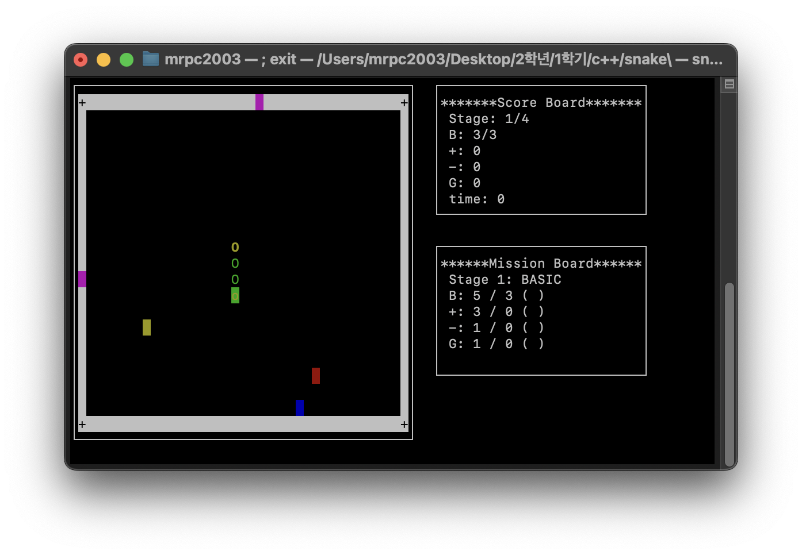

<div align="center">

# 🐍 Snake Game

**C++11 & ncurses 기반 고급 터미널 스네이크 게임**

[](LICENSE)
[](https://isocpp.org/)
[](https://invisible-island.net/ncurses/)

[English](README.md) | 한국어



</div>

---

4개의 고유한 스테이지, 실시간 미션 시스템, 지능형 게이트 순간이동, 풀 컬러 UI를 갖춘 터미널 스네이크 게임입니다. Team 10 C++ 프로그래밍 프로젝트로 개발되었습니다.

## ✨ 주요 특징

- 🎮 **4개의 고유한 스테이지** — BASIC, MAZE, ISLANDS, CROSS (난이도 상승)
- 📊 **실시간 미션 시스템** — 각 스테이지별 달성 목표
- 🎯 **3가지 특수 아이템** — 성장(+), 독(−), 시간 가속(T)
- 🌀 **지능형 게이트 시스템** — 물리 직관 기반 순간이동
- 🎨 **풀 컬러 UI** — 객체별 차별화된 색상 시스템
- 📱 **반응형 인터페이스** — 터미널 크기 자동 대응
- 🛡️ **메모리 안전성** — RAII 패턴과 예외 처리
- ⚡ **최적화된 성능** — Move semantics와 STL 활용

## 🎮 게임 플레이

### 조작법

| 키 | 기능 |
|-----|--------|
| ↑ ↓ ← → | 스네이크 이동 |
| Enter | 메뉴 선택 |
| R | 재시작 |
| E | 종료 |
| D | 디버그: 미션 완료 |
| 1–4 | 디버그: 스테이지 이동 |

### 게임 오브젝트

| 기호 | 객체 | 설명 |
|--------|--------|-------------|
| `>^<v` | 🐍 스네이크 머리 | 방향에 따라 변화하는 노란색 헤드 |
| `O` | 🟢 스네이크 몸통 | 초록색 몸통 세그먼트 |
| `o` | 🟡 스네이크 꼬리 | 노란/초록 그라데이션 꼬리 |
| `+` | 🔵 성장 아이템 | 길이 증가 (파란색) |
| `-` | 🔴 독 아이템 | 길이 감소 (빨간색) |
| `T` | ⏰ 시간 아이템 | 40틱간 1.5배 속도 (노란색) |
| `█` | 🚪 게이트 | 순간이동 포털 (마젠타색) |
| `+` | ⬜ 무적벽 | 파괴 불가능한 경계 |
| `█` | ⬛ 일반벽 | 충돌 시 게임 오버 |

### 스테이지

| 스테이지 | 이름 | 미션 | 속도 | 맵 스타일 |
|-------|------|---------|-------|-----------|
| 1 | BASIC | 길이 5, +3, −1, 게이트 ×1 | 250 ms | 기본 직사각형 |
| 2 | MAZE | 길이 7, +5, −2, 게이트 ×2 | 200 ms | 미로 구조 |
| 3 | ISLANDS | 길이 9, +7, −3, 게이트 ×3 | 170 ms | 분리된 섬 영역 |
| 4 | CROSS | 길이 12, +8, −4, 게이트 ×2 | 150 ms | 회전 십자형 구조 |

## 🛠️ 기술 스택

| 분류 | 상세 |
|----------|---------|
| 언어 | C++11 (Move semantics, Lambda, Template) |
| UI 라이브러리 | ncurses 5.0+ |
| STL | vector, string, chrono 등 |
| 설계 패턴 | RAII, 예외 안전성, 입력 검증 |
| 빌드 | Makefile / CMake 3.12+ |

## 📋 시스템 요구사항

- **OS**: Linux, macOS, WSL
- **컴파일러**: GCC 4.8+ 또는 Clang 3.3+ (C++11 지원)
- **라이브러리**: ncurses 5.0+
- **터미널**: 최소 50×15 (권장 80×25)

## 🚀 설치 및 실행

### 종속성 설치

```bash
# Ubuntu / Debian
sudo apt-get update
sudo apt-get install build-essential cmake libncurses5-dev git

# macOS (Homebrew)
brew install cmake ncurses git

# CentOS / RHEL
sudo yum install gcc-c++ cmake ncurses-devel git
```

### 빌드

```bash
git clone https://github.com/mrpc2003/SnakeGame_Team10.git
cd SnakeGame_Team10

# 방법 1: Makefile (추천)
make clean && make

# 방법 2: CMake
mkdir build && cd build
cmake ..
make
```

### 실행

```bash
./bin/snake_game
```

## 🏗️ 프로젝트 구조

```
SnakeGame_Team10/
├── src/
│   ├── main.cpp          # 게임 진입점 및 메뉴 시스템
│   ├── game.h            # 게임 로직 및 UI 관리
│   ├── map.h             # 맵 생성 및 스테이지 관리
│   └── block.h           # 게임 오브젝트 클래스
├── img/
│   └── ingame1.png       # 게임 플레이 스크린샷
├── CMakeLists.txt        # CMake 빌드 설정
├── Makefile              # Make 빌드 설정
├── LICENSE               # MIT 라이선스
└── README.md
```

## 🎯 고급 기능

### 지능형 게이트 시스템
- **물리 직관 반영**: 진입 방향 기반 출구 방향 우선순위
- **충돌 방지**: 막힌 출구 자동 감지 및 대안 경로 선택
- **방향 우선순위**: 직진 → 시계방향 → 반시계방향 → 역방향

### 동적 UI 시스템
- **터미널 크기 감지**: 실시간 화면 크기 대응
- **적응형 레이아웃**: 작은 화면에서 축약된 정보 표시
- **안전한 메시지 처리**: 긴 텍스트 자동 줄바꿈 및 말줄임표

### 안전성 보장 시스템
- **메모리 누수 방지**: RAII 패턴으로 100% 자동 정리
- **예외 안전성**: 모든 런타임 오류 상황 처리
- **입력 검증**: 역방향 이동 방지 및 유효성 검사

## 🐛 문제 해결

```bash
# 클린 빌드
make clean && make

# 권한 문제 시
chmod +x bin/snake_game

# ncurses 설치 확인
pkg-config --exists ncurses && echo "OK" || echo "ncurses 설치 필요"

# 크래시 후 터미널 리셋
reset

# 최적화 빌드
CXXFLAGS="-std=c++11 -O2 -DNDEBUG" make
```

## 📊 성능 지표

| 항목 | 수치 |
|--------|-------|
| 메모리 사용량 | ~2 MB |
| CPU 사용률 | < 5% |
| 입력 지연 | < 50 ms |
| 프레임율 | 5–6.67 FPS |

## 🤝 개발팀

**Team 10** — 2024년 C++ 고급 프로그래밍 과목

## 📄 라이선스

이 프로젝트는 [MIT 라이선스](LICENSE) 하에 배포됩니다.

## 🔗 참고 자료

- [프로젝트 수행결과 보고서](10팀-SnakeProject-수행결과보고서.docx)
- [게임플레이 동영상](스네이크%20프로젝트%20단계별%20설명%20영상_Team%2010.mov)
- [ncurses 라이브러리 문서](https://invisible-island.net/ncurses/)

---

<div align="center">

⭐ 이 프로젝트가 도움이 되었다면 별표를 눌러주세요!

🎮 **Happy Gaming!** 🐍

</div>
