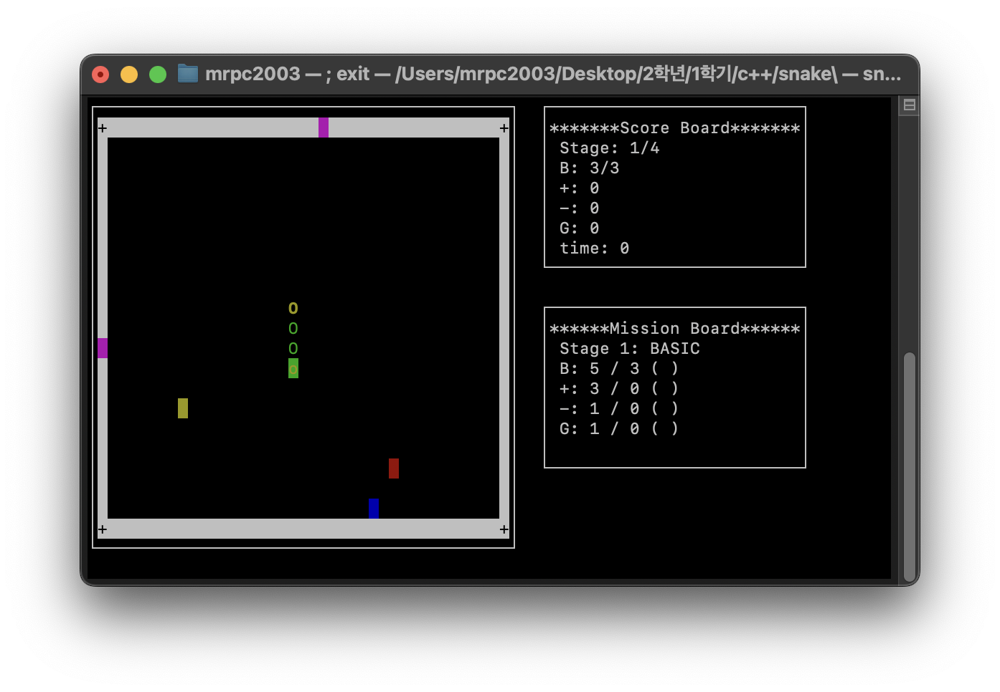

<div align="center">

# 🐍 Snake Game

**Advanced Terminal Snake Game built with C++11 & ncurses**

[](LICENSE)
[](https://isocpp.org/)
[](https://invisible-island.net/ncurses/)

English | [한국어](README.ko.md)



</div>

---

A feature-rich terminal snake game with 4 unique stages, a real-time mission system, intelligent gate teleportation, and full-color UI — developed as a Team 10 C++ programming project.

## ✨ Features

- 🎮 **4 Unique Stages** — BASIC, MAZE, ISLANDS, CROSS with increasing difficulty
- 📊 **Real-time Mission System** — Per-stage objectives to complete
- 🎯 **3 Special Items** — Growth (+), Poison (−), Time Accelerator (T)
- 🌀 **Intelligent Gate System** — Physics-intuitive teleportation portals
- 🎨 **Full-color UI** — Distinct color coding per game object
- 📱 **Responsive Interface** — Adapts to terminal size automatically
- 🛡️ **Memory Safety** — RAII patterns and exception handling
- ⚡ **Optimized Performance** — Move semantics and STL utilization

## 🎮 Gameplay

### Controls

| Key | Action |
|-----|--------|
| ↑ ↓ ← → | Move snake |
| Enter | Select menu item |
| R | Restart |
| E | Exit |
| D | Debug: complete mission |
| 1–4 | Debug: jump to stage |

### Game Objects

| Symbol | Object | Description |
|--------|--------|-------------|
| `>^<v` | 🐍 Snake Head | Yellow head changes with direction |
| `O` | 🟢 Snake Body | Green body segments |
| `o` | 🟡 Snake Tail | Yellow/green gradient tail |
| `+` | 🔵 Growth Item | Increases length (blue) |
| `-` | 🔴 Poison Item | Decreases length (red) |
| `T` | ⏰ Time Item | 1.5× speed for 40 ticks (yellow) |
| `█` | 🚪 Gate | Teleportation portal (magenta) |
| `+` | ⬜ Immune Wall | Indestructible boundary |
| `█` | ⬛ Wall | Game over on collision |

### Stages

| Stage | Name | Mission | Speed | Map Style |
|-------|------|---------|-------|-----------|
| 1 | BASIC | Length 5, +3, −1, Gate ×1 | 250 ms | Simple rectangle |
| 2 | MAZE | Length 7, +5, −2, Gate ×2 | 200 ms | Maze corridors |
| 3 | ISLANDS | Length 9, +7, −3, Gate ×3 | 170 ms | Separated island regions |
| 4 | CROSS | Length 12, +8, −4, Gate ×2 | 150 ms | Rotating cross/× shape |

## 🛠️ Tech Stack

| Category | Details |
|----------|---------|
| Language | C++11 (move semantics, lambdas, templates) |
| UI Library | ncurses 5.0+ |
| STL | vector, string, chrono, etc. |
| Patterns | RAII, exception safety, input validation |
| Build | Makefile / CMake 3.12+ |

## 📋 Requirements

- **OS**: Linux, macOS, or WSL
- **Compiler**: GCC 4.8+ or Clang 3.3+ (C++11 support)
- **Library**: ncurses 5.0+
- **Terminal**: Minimum 50×15 (recommended 80×25)

## 🚀 Build & Run

### Install Dependencies

```bash
# Ubuntu / Debian
sudo apt-get update
sudo apt-get install build-essential cmake libncurses5-dev git

# macOS (Homebrew)
brew install cmake ncurses git

# CentOS / RHEL
sudo yum install gcc-c++ cmake ncurses-devel git
```

### Build

```bash
git clone https://github.com/mrpc2003/SnakeGame_Team10.git
cd SnakeGame_Team10

# Option 1: Makefile (recommended)
make clean && make

# Option 2: CMake
mkdir build && cd build
cmake ..
make
```

### Run

```bash
./bin/snake_game
```

## 🏗️ Project Structure

```
SnakeGame_Team10/
├── src/
│   ├── main.cpp          # Entry point & menu system
│   ├── game.h            # Game logic & UI management
│   ├── map.h             # Map generation & stage management
│   └── block.h           # Game object classes
├── img/
│   └── ingame1.png       # Gameplay screenshot
├── CMakeLists.txt        # CMake build config
├── Makefile              # Make build config
├── LICENSE               # MIT License
└── README.md
```

## 🎯 Advanced Mechanics

### Intelligent Gate System
- **Physics-intuitive exit**: Exit direction prioritized based on entry angle
- **Collision avoidance**: Blocked exits detected automatically with fallback routing
- **Priority order**: Straight → Clockwise → Counter-clockwise → Reverse

### Dynamic UI System
- **Terminal size detection**: Real-time screen adaptation
- **Adaptive layout**: Condensed info display on smaller terminals
- **Safe text handling**: Auto line-wrap and ellipsis for long messages

### Safety Guarantees
- **No memory leaks**: RAII ensures 100% automatic cleanup
- **Exception safety**: All runtime error scenarios handled
- **Input validation**: Reverse-direction prevention and bounds checking

## 🐛 Troubleshooting

```bash
# Clean rebuild
make clean && make

# Permission fix
chmod +x bin/snake_game

# Verify ncurses is installed
pkg-config --exists ncurses && echo "OK" || echo "ncurses not found"

# Terminal reset after crash
reset

# Optimized build
CXXFLAGS="-std=c++11 -O2 -DNDEBUG" make
```

## 📊 Performance

| Metric | Value |
|--------|-------|
| Memory usage | ~2 MB |
| CPU usage | < 5% |
| Input latency | < 50 ms |
| Frame rate | 5–6.67 FPS |

## 🤝 Team

**Team 10** — C++ Advanced Programming Course, 2024

## 📄 License

This project is licensed under the [MIT License](LICENSE).

## 🔗 References

- [Project Report (Korean)](10팀-SnakeProject-수행결과보고서.docx)
- [Gameplay Video](스네이크%20프로젝트%20단계별%20설명%20영상_Team%2010.mov)
- [ncurses Documentation](https://invisible-island.net/ncurses/)

---

<div align="center">

⭐ Star this repo if you found it useful!

🎮 **Happy Gaming!** 🐍

</div>
